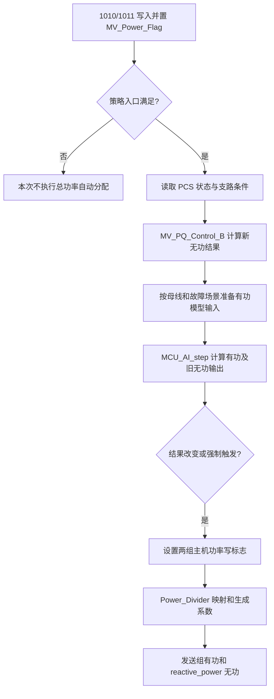

# LC最新有功与无功策略详解

分析日期：2026-11-27。分析对象：当前工作区 `logger` 源码，包括工作区已有修改，非某个已发布固件的反编译结果。

本文沿用讨论中的台达 PCS 场景，重点解析总有功、总无功分配，并解释按组直写、PF 模式和黑启动的区别。天合使用另一套入口和算法，不适用本文结论。

本文为静态代码分析。公式用于解释代码逻辑；标为“示例”的数值不是设备实测结果。PCS 是否接受并执行某种模式下的指令，需要协议和设备反馈进一步确认。

## 1. 首先区分三条控制路径

| 路径 | 输入 | 处理方式 | 是否进入总功率分配 |
|---|---|---|---|
| 总有功、总无功 | 保持寄存器 1010、1011 | 根据设备状态计算，再生成各组指令 | 是，但必须满足策略入口 |
| 按组功率参考 | 27052/27053、27352/27353 | 0x06 写入时通常直接进入 PCS 队列 | 否；有功在 PF 模式反馈有效时例外 |
| PF 控制 | 组有功、功率因数等 | `PF_Convert()` 转换后发送 S、PF | 不走同一套总 P/Q 分配 |

需要区分四个不同事件：寄存器写入成功、计算执行、发送报文、PCS 实际采用指令。前一个事件不能证明后一个已经发生。

## 2. 地址、设备和变量含义

### 2.1 主要寄存器

| 地址 | 用途 |
|---|---|
| HOLD 3 | EMS 远程控制使能；TCP 写请求仅在值为 1 时放行 |
| HOLD 1010 | 整机总有功目标，赋给 `int16_T mv_power` |
| HOLD 1011 | 整机总无功目标；新算法按有符号 16 位解释 |
| HOLD 27016 / 27316 | 第一组 / 第二组 PQ 模式标志 |
| HOLD 27017 / 27317 | 第一组 / 第二组 PF 模式标志 |
| HOLD 27021 / 27321 | 第一组 / 第二组黑启动模式标志 |
| HOLD 27052 / 27352 | 第一组 / 第二组有功参考 |
| HOLD 27053 / 27353 | 第一组 / 第二组无功参考 |
| INPUT 17060 / 17360 | 主机运行和故障状态；有功场景选择使用 bit3、bit4 |
| INPUT 17062 / 17362 | 从机状态；有功场景选择使用 bit2 运行、bit1 故障等 |
| INPUT 17061、17062、17361、17362 | 新无功算法使用的四台 PCS 支路状态 |
| INPUT 17031 / 17331 | 新无功算法公布的每组平衡后无功能力 |
| INPUT 117 | 新无功算法公布的总平衡无功能力 |

`HOLD` 与 `INPUT` 是不同寄存器空间，不要仅凭数值相近将它们混同。

### 2.2 分组与符号

- Group1：第一组主机和从机；Group2：第二组主机和从机。
- 发送给两组主机的线程编号分别是 `num=0`、`num=2`。
- 有功正值表示放电，负值表示充电。
- 无功保留目标的正负号；本文不根据代码自行给正负号附加“容性/感性”的设备协议定义。
- 功率系数基准是 1000，即 1000 对应 100%。
- `pcs1_power` 等名称不能在所有故障场景下直接理解为固定物理 PCS。模型输入可能被压缩重排，随后由 `Power_Divider()` / `Power_Divider1()` 映射回物理位置。

## 3. 自动策略的入口与执行顺序

### 3.1 入口条件

`Pcs_Taida_Write_Task()` 中，先满足 `GET_INPUT(P2P_mode)==0`。只在主机线程 0、2 中尝试执行总功率分配：

```c
if (((GET_HOLD(27016) == 1) || (GET_HOLD(27316) == 1)) &&
    ((state == SYSRun) || (state == SYSWarnRun))) {
    if (pthread_mutex_trylock(&g_mv_alloc_call_mtx) == 0) {
        MV_Power_allocate1();
        pthread_mutex_unlock(&g_mv_alloc_call_mtx);
    }
}
```

注意三个细节：

1. PQ 条件是两组“或”，不是当前组单独检查。混合模式时，不能据此证明非 PQ 的那组不会收到指令。
2. `state` 是当前主机线程对应系统的状态。任一符合条件的主机线程可以调用整机分配函数。
3. `trylock` 失败时该次跳过，不会阻塞等待。线程有通信和休眠，不应把策略描述为严格固定毫秒周期。

进入运行状态的上升沿还会设置 `init_power_flag=1`，用于触发初始下发。

### 3.2 实际调用顺序



重要：新无功计算在本轮有功模型计算之前执行，而且读取的是组有功参考及系数寄存器，不是本轮 `MCU_AI_step()` 刚算出的有功结果。

### 3.3 1010/1011 不是直接透传地址

0x06 接口处理这两个地址时主要执行：保存寄存器、`MV_Power_Flag=true`。该分支没有直接给 `pcsnum` 指定设备并将 1010/1011 入队。

随后分配函数在发现有功结果改变、无功结果改变、`MV_Power_Flag` 或 `init_power_flag` 有效时，才设置：

```c
PCS_Write_Flag[0] = true;
PCS_Write_Flag[2] = true;
PCSaddr[0] = 1010;
PCSaddr[2] = 1010;
```

这里队列中的 1010 是内部“执行整组功率发送”的特殊标识。不是把外部 1010 原值原封不动写给 PCS。

## 4. 有功策略：状态筛选、SOC 分配、能力限幅、物理映射

### 4.1 场景选择先于模型计算

`MV_Power_allocate1()` 根据 `BusType` 进入 D_BUS 或 S_BUS 分支，随后用一系列 `if/else if` 匹配主从机组合：全部运行、某台故障、从机不运行、只剩一组、只剩一台等。

各场景负责配置：

- 有效 BMS 充放电能力及 SOC；
- 模型的 `module_num` 和各 PCS 额定功率；
- 整机 `mv_max_power`；
- `bus2_or_bus1`、目标 SOC 上下限；
- 模型输入位置和实际物理设备的对应关系。

它不是一条统一的“在线台数乘额定功率”表达式，而是显式场景表。场景编号、注释和实际条件需要一起看，不能只读注释。

### 4.2 BMS 能力与支路屏蔽

以 D_BUS 第一支路为例：

```text
SOC                 <- INPUT 38003
最大放电能力         <- INPUT 38037
最大充电能力         <- INPUT 38038
充放电许可状态       <- INPUT 38071
```

其他 BMS 常按 200 地址间隔排列，但故障场景会将物理 BMS 重排到模型槽位。

正常写法中：

```text
许可状态为 0 或 2，且支路允许：读取充电能力；否则置 0。
许可状态为 0 或 1，且支路允许：读取放电能力；否则置 0。
```

`PCSxBUSy` 来自相关状态寄存器的组合条件，主机和从机读取位置不完全相同。它不是仅由 BMS 允许值决定。

**实际代码例外：** 部分条件缺少包住两个 OR 项的括号，例如 D_BUS 单主机场景的 BMS6：

```c
(GET_INPUT(39071) == 0) ||
(GET_INPUT(39071) == 2) && (PCS3BUS2 == 1)
```

按 C 优先级，许可状态为 0 时不会再要求 `PCS3BUS2==1`。因此“所有支路都严格受同样屏蔽”不是当前代码的准确描述。

### 4.3 单/双母线与额定功率

| 项目 | D_BUS | S_BUS |
|---|---|---|
| 模型标志 | `bus2_or_bus1=1` | `bus2_or_bus1=0` |
| 正常全部运行时槽位数 | 8 | 4 |
| 模型主要分支 | 八路分配 | 四路分配 |
| 发送前映射 | `Power_Divider1()` | `Power_Divider()` |

普通场景宏定义为：四台 10000、三台 7500、两台 5000、单台 2500，单 PCS 额定有功 2500。D_BUS 中每台 PCS 对应的两路模型能力分别受额定功率的一半约束；不能把每路都按整台容量计算。

故障场景会减少模块数或额定能力。物理输出位置由后续映射恢复，不能只根据 `module_num` 判断哪个物理主机被排除。

### 4.4 单主机模式是特定场景分支

在“两套主机运行、两套从机不运行”的场景中，`singlePcsMaster==1` 有特殊处理：

- D_BUS 保持 8 个模型位置，非参与从机对应能力置零，主机数据保留在相应槽位。
- S_BUS 保持 4 个模型位置，参与位置为第一、第三个，其余能力置零。
- 两种情况下设置 `mv_max_power=5500`、各 `pcs*_rated_power=2750`。
- `Power_Divider*()` 同样有对应映射分支。

不能泛化为“打开 singlePcsMaster 后所有场景均忽略从机条件”；入口仍有原来的场景条件。

### 4.5 SOC 上下限和方向

当前调用层多数场景明确传入 `target_h_soc=1000`、`target_l_soc=0`。模型先取二者最大值、最小值作为上下限。

对于支路 i，记充电能力为 C_i、放电能力为 D_i：

```text
SOC_i >= H：该路模型充电能力置零。
SOC_i <= L：该路模型放电能力置零。
```

随后与 PCS 分摊到该路的容量限制取较小值。SOC 输入还用于分配权重，而不是只用于到限关断。

### 4.6 总目标先做能力裁剪

用等价含义表达模型的总目标裁剪：

```text
P_min = -min(整机最大功率, 有效充电能力之和)
P_max =  min(整机最大功率, 有效放电能力之和)
P_target = clamp(P_request, P_min, P_max)
```

这里的有效能力已经经过方向许可、SOC、模块和容量处理。目标为正选放电方向，为负选充电方向。

该式解释能力边界，不代表模型最终整数输出必然精确求和到 `P_target`。内部还有分组约束、阈值、截断、舍入及剩余量分配。

### 4.7 SOC 权重、初分配和余量处理

方向权重为：

```text
放电：w_i = max(SOC_i - L, 0)
充电：w_i = max(H - SOC_i, 0)
```

不存在的模型槽位被排除；代码使用零权重、排序哨兵和模块数条件处理它们。

因此，在能力相同且没有限幅时，放电偏向 SOC 较高支路，充电偏向 SOC 较低支路。权重是到边界的余量，不是 SOC 差值均衡 PID，也不是直接按 BMS 最大功率比例分配。

模型包括如下实际运算：

1. 按权重形成初分配；D_BUS 包含成对支路先分配到 PCS、再分到支路的结构。
2. 将各路结果限制在允许充放电范围内，消除与目标方向相反的值。
3. 计算限幅后剩余的功率以及各路剩余能力。
4. 对权重排序并通过展开的 switch-case 分支处理余量，再恢复原槽位顺序。
5. 对输出执行小量清零和整数转换。

**不要把整套模型简化成 `P_i=P_total*w_i/sum(w)`。** 该式仅适合说明未触发限幅、分组约束和阈值时的权重关系。精确逐点结果应运行 `MCU_AI_step()` 验证。

例如仅看两个未受限支路，SOC 为 800、400，上下限为 1000、0：放电权重比是 2:1，充电权重比是 1:3。若某路触及能力上限，最终比例将改变。

代码还存在权重和接近零时的保护分母、`<=0.1` 清零、部分中间值直接截断和最终 `rt_roundf_snf()` 舍入。不要假定每一级都用同一种四舍五入。

### 4.8 映射为组功率和系数

模型输出先经过物理映射，再生成下发内容：

```text
组有功 = 该组物理输出之和
系数一般形态 = 某路物理输出 × 1000 / 组输出
```

系数限制在 0～1000，整数除法存在截断。零总功率有默认系数处理，例如 S_BUS 部分分支使用 500。

注意系数不是所有场景都完全按上述通式计算：故障和单主机场景包含补数等特殊写法。例如 D_BUS 单主机场景存在 `masterbat2_powerate=1000-masterbat1_powerate`，必须结合该场景实际映射理解。

S_BUS：分别发送方向对应系数、组有功参考、组无功参考。D_BUS：构造从地址 104 开始的 8 个寄存器，包括 3 个放电系数、3 个充电系数、P、Q；当前方向使用计算系数，另一方向在该发送路径写入 250。

## 5. 无功策略：方案 B 的完整计算

### 5.1 实际发送源与旧模型必须分开

当前路径为：

```text
GET_HOLD(1011)
  -> MV_PQ_Control_B()
  -> reactive_power.group1_q_cmd / group2_q_cmd
  -> PCS 组无功寄存器
```

`MCU_AI_step()` 也计算 `pcs_r_power1_2 / pcs_r_power3_4`，并会使用 `reactive_rate` 等旧输入；`Power_Result` 也保留旧无功字段。但当前自动发送路径选择的是 `reactive_power`。

因此：

- 场景注释中的“发有功，不发无功”不必然符合当前实际发送。
- 场景里的 `mv_r_power=0` 不能证明最终组无功为零。
- `sys_cfg->reactiverate` 不参与新 `reactive_allocate.c` 的能力限制，不能认为配置它就限制了当前自动下发的 Q。
- `Allocate_Single_Mode_Case7_Reactive()` 虽有声明和定义，但在当前文件中没有调用，不能当成现行无功策略。

### 5.2 从组参考和系数估算每台有功

以第一组为例：

```text
P_group = signed16(HOLD 27052)
k_discharge = min(HOLD 27050 + HOLD 27046, 1000)
k_charge    = min(HOLD 27051 + HOLD 27048, 1000)
```

放电选择 `k_discharge`，充电选择 `k_charge`：

```text
P_master = trunc(P_group * k / 1000)
P_slave  = P_group - P_master
```

第二组地址整体加 300。减法计算从机值使两台计划有功之和保持为组参考。

这里并非读取实时测量 P，也没有直接读取本轮新模型输出。主机份额使用两个主机支路系数之和，剩余份额全部给从机。

### 5.3 支路状态决定有效视在容量

| PCS | 状态寄存器 |
|---|---:|
| 第一组主机 | INPUT 17061 |
| 第一组从机 | INPUT 17062 |
| 第二组主机 | INPUT 17361 |
| 第二组从机 | INPUT 17362 |

解析位如下：bit8/bit9 为两支路运行，bit10/bit11 为待机，bit12/bit13 为故障。

**实际容量只使用 bit8、bit9。** 待机和故障位被解析但未参与容量扣减：

| 运行支路数 | S |
|---:|---:|
| 0 | 0 kVA |
| 1 | 1250 kVA |
| 2 | 2500 kVA |

`PCS_Q_IsAvailable()` 判断的是 `S>0`，不是 `Qmax>0`。所以一台 PCS 有运行支路，但有功已占满 S 时，会计入可用台数，同时提供零无功能力。

### 5.4 每台与每组的能力

```text
S<=0 或 |P|>=S：Qmax=0
否则：Qmax=sqrt(S*S-P*P)
```

每组的能力是该组两台的能力之和：

```text
Qmax_g1 = Qmax_master1 + Qmax_slave1
Qmax_g2 = Qmax_master2 + Qmax_slave2
Qbalance = min(Qmax_g1, Qmax_g2)
```

它不是先把每组 S、P 相加后再求一次平方根；两者在不均衡负载下可能不同。

### 5.5 平衡优先和故障退化

如果任意一组可用台数为零，直接令两组 Q 指令和公布能力为零。

否则：

```text
Q_half = signed16(HOLD 1011) / 2.0
Q_group = clamp(Q_half, -Qbalance, +Qbalance)
Q1_cmd = trunc(Q_group)
Q2_cmd = trunc(Q_group)
```

当前方案 B 关闭单台补偿。某组只剩一台时，不把组指令乘 2，也不把该组不足部分转移到另一组。

这实现的是两组参考值相等、以弱组为限的策略，不是整机无功能力最大化。PCS 内部是否把组目标正确交给剩余单台，仍属于设备执行语义。

代码还保留方案 A，但当前入口没有调用 A。A 会在组内仅一台可用时放大组设置值，不能混入 B 的解释。

### 5.6 能力上报与数值边界

```text
INPUT 17031 = trunc(Qbalance)
INPUT 17331 = trunc(Qbalance)
INPUT 117   = trunc(2*Qbalance)
```

这些是平衡约束后的能力，不是两组原始能力之和。分别截断会使总上报与两个已截断组上报之和存在 1 的差异。

指令转换向零截断，并保护在 int16 范围内；通过 uint16 容器保留有符号编码。总目标为奇数时，等分再截断可能少 1 个单位，例如 101 得到 50+50，-101 得到 -50-50。

### 5.7 无功例子

| 场景 | 结果 |
|---|---|
| 两组能力各 3000，目标 1000 | 两组各 500 |
| 两组能力 800、300，目标 1000 | 两组各 300，总计 600 |
| 第一组无运行支路，第二组能力充足 | 两组均为 0 |
| 两组均可用但某组所有运行 PCS 的有功已占满 S | 弱组能力为 0，两组均为 0 |
| 某组仅剩一台可用且能力足够 | 继续各承担一半，不乘 2 |
| 目标 -1000，平衡能力 300 | 两组各 -300 |

单台示例：S=2500、P=2000 时，Qmax=1500；如果该台只剩一支路，S=1250 而计划 P 仍为 2000，则 Qmax=0。

## 6. 有功与无功之间的实际关系

当前不是 P/Q 联合优化：有功模型没有为了满足新的 Q 目标而主动减少 P 的统一闭环；新无功模块按已有有功参考计算剩余能力。

因此可描述为“Q 使用 P 占用后的剩余容量”，但不能进一步宣称“本轮同时算出的 P/Q 一定严格满足每台容量圆”。原因包括：

1. Q 先算，P 后算。
2. Q 使用参考寄存器和系数，存在读回/更新时序。
3. 两台主机发送分开进行，并不是整机同步原子提交。
4. 单主机有功场景可设置额定 2750，而新 Q 的双支路 S 固定为 2500。

实际应观察各组 P 参考、系数、支路状态和报文先后顺序，不能只看同一条策略日志。

## 7. 按组直写、PF 与黑启动

### 7.1 0x06 直接写组 P/Q

TCP 0x06 处理：

- 27053 入第一组主机队列，27353 入第二组主机队列。
- 27052/27352 在对应 INPUT 17064/17364 的 bit1（PF 模式反馈）为零时直接入队；为一时只更新 PF 路径使用的 `PCSactivepower`。
- 发送函数把组 P/Q 映射为设备偏移 110/111，即代码中的 40111-40001、40112-40001。
- 此路径不调用总功率模型，也不执行新无功能力限幅。

因此直接给组有功，不会自动重算组内系数；原系数仍可能影响组内实际分担。直接写组 Q，也不是运行本文的无功方案 B。

### 7.2 0x10 不能等同于 0x06

当前 TCP 多寄存器处理有独立分支。27052 落入直接入队区间，而 27053 落在外层其他地址分支，又不满足其内部映射区间，因此没有对应入队动作；第二组同理。

例如从 27052 连写两个寄存器，不能因为收到成功响应就认为 P、Q 都已转发。当前观察到的是 P 具有入队路径，Q 更新本地值但不由该分支直接发送。后续其他策略是否读取并覆盖这些值是另一件事。

本文对“直接写可以下发”的结论限定为已核对的 0x06 路径，不泛化到所有写功能码。

### 7.3 PF 是独立路径

写线程检查 `27017==1 || 27317==1`，且当前系统为 `SYSRun/SYSWarnRun` 时执行 `PF_Convert()`。转换后向设备偏移 112、113 写 S、PF。

PF 的入口也使用跨组 OR。不能把 PF 控制、PQ 总分配和直写 P 当成完全等价的接口。

### 7.4 黑启动状态下到底能做什么

状态任务发现任一黑启动标志有效，会对各系统执行黑启动状态机。流程中的运行状态是 `SYSBLACKRun`，不同于 `SYSRun`。

| 操作 | 稳定处于 SYSBLACKRun 时的代码行为 |
|---|---|
| 写总目标 1010/1011（已核对的 0x06） | 保存和置标志，但自动分配入口不满足 |
| 自动有功计算 | 不进入 |
| 自动无功方案 B | 不进入 |
| 0x06 写组 P/Q | 条件满足时仍可入队并发送；P 有 PF 反馈例外 |
| PCS 是否执行组 P/Q 目标 | 本项目代码不能单独证明 |

公共条件包括远程使能、通信正常及写线程 `P2P_mode==0`。黑启动自动策略不执行，不意味着 PCS 无有功/无功输出，也不意味着发送队列被清空或所有功率写命令都被禁止。

## 8. 影响解释和后续修改的实现问题

以下是当前静态代码可见事实或由事实引出的待验证影响，不是本次已经修复的问题。

| 观察 | 影响 |
|---|---|
| PQ/PF 判断是跨组 OR | 不构成严格的每组模式隔离 |
| 未匹配场景只记录“不在分配范围内”，之后仍执行 MCU_AI_step | 存在沿用上次全局模型输入的可能；不是默认全部清零 |
| 新 Q 只按支路运行位评估容量 | 若运行位与故障位同时有效，故障位不会单独扣除容量 |
| 新 Q 不读取 singlePcsMaster | 从机是否参与完全取决于它读到的支路状态，不能仅凭配置保证排除 |
| 新 Q 不使用 reactiverate | 旧限额配置不等于实际新 Q 限额 |
| Q 先算，P 后算，且 Q 用参考/系数 | 功率突变时需验证同周期一致性 |
| 单主机场景 P 额定 2750，Q 的 S 固定 2500 | 两套额定口径不同，应明确设备依据 |
| 部分 BMS 判断缺括号 | 某些许可状态可能绕过支路条件 |
| 模型旧 Q、映射旧 Q、新 reactive_power 同时存在 | 日志和注释可能误导实际下发判断 |
| 0x06/0x10 路径不一致 | 相同地址、不同功能码可出现不同下发结果 |
| 总分配和直写组参考同时存在 | 正常 PQ 自动策略后续可能覆盖直接写入的值 |
| 触发标志在生成发送标志时被清除 | 标志清除不代表 PCS 已成功执行 |

不能仅凭当前代码推断“没有并网就必然不能发功率”。自动入口没有独立并网联锁判断；其限制主要是模式、系统状态和设备能力。也不能反过来推断离网控制能力已经验证。

## 9. 推荐的核对用例与观测值

本节是后续验证建议，未在本次文档任务中连接设备执行。

| 用例 | 要观察的结果 |
|---|---|
| 正常 PQ，四台运行，等 SOC | 有功能力、物理映射及组系数是否一致 |
| 不同 SOC，充放电各一次 | 权重方向是否符合高 SOC 多放、低 SOC 多充 |
| 某一路 BMS 能力很小 | 该路限幅、余量处理、总实际目标 |
| SOC 达 0/1000 | 相应方向能力清零 |
| 主机或从机退出 | 场景、module_num、输出位置映射 |
| singlePcsMaster 开启 | 主机位置保留、从机能力为零、5500/2750 参数 |
| Q 目标大于弱组能力 | 两组等值，按弱组限幅 |
| 任一组无支路运行 | 两组 Q 为零 |
| P 参考突变 | 新 P 下发与 Q 重算之间的时间关系 |
| 黑启动运行写 1010/1011 | 只更新目标，不进入自动计算 |
| 黑启动运行 0x06 写组 P/Q | 队列、实际报文、PCS 回读与测量分别确认 |
| 0x10 连写 27052/27053 | 检查 Q 未直接入队问题 |

建议同时采集：系统状态、PQ/PF/黑启动标志、1010/1011、组 P/Q 参考、各组系数、四台支路状态、BMS 能力与 SOC、实际 Modbus 请求/响应、PCS 实测 P/Q。只看 1010/1011 回读或一条“已下发”日志不足以验证策略。

## 10. 源码导航

以下路径相对本文所在的 `logger` 目录；行号是分析时位置，后续修改可能移动。

| 文件与大致行号 | 内容 |
|---|---|
| [pcs/pcs_taida_write.c](pcs/pcs_taida_write.c)，807～865 | 自动 PQ/PF 入口与写线程 |
| 同文件，327～429 | 总功率标识 1010 的实际组指令发送 |
| 同文件，450～474 | 常规队列地址映射与单寄存器发送 |
| 同文件，928 起、1635 附近起 | 单/双母线输出物理映射 |
| 同文件，2779 起 | 总功率分配、场景输入与新 Q 调用 |
| 同文件，3661 起、5312 起 | 单主机特殊输入场景 |
| 同文件，4629、6094 附近 | MCU_AI_step 和变更触发 |
| 同文件，6423 起 | PF 转换 |
| [pcs/pcs_taida_write.h](pcs/pcs_taida_write.h)，7～26 | 设备寄存器偏移和功率宏 |
| [logic/MCU_AI.c](logic/MCU_AI.c)，122 起 | 自动生成的有功和旧无功模型 |
| 同文件，150～740 | 双母线 SOC、能力、总目标及权重 |
| 同文件，1086 起、5600 附近起 | 排序和展开的分配处理 |
| 同文件，7029 起 | 输出选择、取整及旧 Q 处理 |
| [logic/reactive_allocate.c](logic/reactive_allocate.c)，160～200 | 从有功参考和系数估算单台 P |
| 同文件，220～440 | 支路容量、单台和组 Q 能力 |
| 同文件，490～613 | 双组平衡、目标限幅及上报 |
| 同文件，668～710 | 当前方案 B 包装和调用 |
| [logic/reactive_allocate.h](logic/reactive_allocate.h) | 容量常量和结果结构 |
| [tcp_server/modbus_tcp_server.c](tcp_server/modbus_tcp_server.c)，350 起 | 远程使能与功能码分支 |
| 同文件，458 起、719 起 | 0x10 与 0x06 写入差异 |
| 同文件，1115～1225 | 台达组功率、PF 分流、总功率触发和入队 |
| [base/address_map.c](base/address_map.c)，222～223 | 组 P/Q 到 PCS 地址映射 |
| [logic/state_task.c](logic/state_task.c)，105～135 | 正常/黑启动状态机选择 |
| [logic/blackstart_sys.c](logic/blackstart_sys.c)，175～190 | 黑启动状态转换 |

